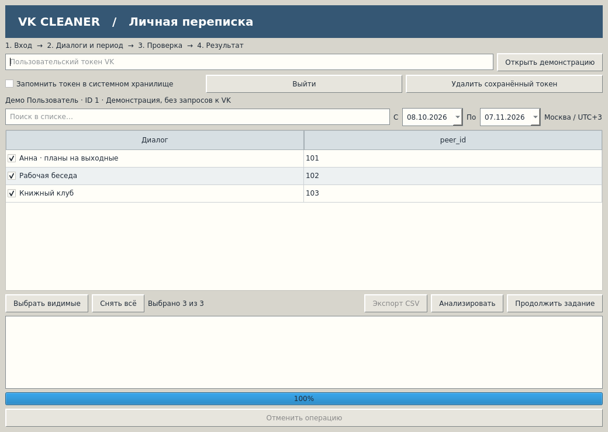

# VK Cleaner

Локальная программа для удаления своих сообщений ВКонтакте за выбранный период.
Выберите переписки, проверьте список и исключите сообщения, которые хотите оставить.
Интерфейс напоминает настольные утилиты начала нулевых: обычные таблицы, кнопки и
никаких аккаунтов на дополнительных сервисах.



**Ранняя версия для Linux.** Демонстрационный сценарий проверен автоматически.
Чтение и удаление через реальный пользовательский токен ещё требуют ручной проверки.
Не начинайте с массового удаления личной переписки: сначала проверьте тестовый диалог.
Удаление для всех необратимо, а ограничения VK могут зависеть от токена и приложения.

## Запуск

Нужны Linux с графическим окружением и Python 3.11 или новее.

```bash
python3 -m venv .venv
source .venv/bin/activate
pip install -e .
vk-cleaner --demo
```

Демонстрация работает без интернета и токена, использует вымышленные сообщения
и временную базу. Для обычного запуска:

```bash
vk-cleaner
```

Если Qt сообщает о недостающей библиотеке платформы xcb, установите зависимости
Qt для своего дистрибутива (часто нужны `libxcb-cursor` и `libxkbcommon-x11`).

## Как пользоваться

1. Введите пользовательский токен VK. Программа проверит аккаунт и загрузит диалоги.
2. Отметьте нужные переписки и задайте даты. Поиск сохраняет сделанный выбор.
3. Запустите анализ, проверьте сообщения и снимите лишние галочки. Список можно
   экспортировать в CSV до удаления.
4. Подтвердите удаление для всех. При отмене текущий запрос завершается,
   а следующий пакет не отправляется.

Если программу закрыли, войдите тем же аккаунтом и нажмите «Продолжить задание».
Если результат запроса неизвестен, автоматическое продолжение заблокируется.
Отсутствие сообщения в собственной истории не доказывает его удаление у собеседника.

## Данные на компьютере

Токен по умолчанию остаётся только в текущем сеансе. Для сохранения в системном
хранилище установите `pip install -e '.[keyring]'` и включите соответствующую опцию.
Ошибка хранилища не приводит к записи токена в текстовый файл.
После работы отзовите токен через настройки подключённых сервисов VK.

База заданий находится в пользовательском каталоге данных `vk-cleaner`
(обычно `~/.local/share/vk-cleaner/cleaner.sqlite3`). Предпросмотр сохраняет фрагменты
до 200 символов после вашего согласия. После успешного завершения задания они
очищаются; идентификаторы и результаты остаются. Пока отдельной кнопки очистки
локальной истории нет: удаляйте базу только при закрытой программе, учитывая потерю
возможности возобновить задания. CSV сохраняется отдельно по вашему запросу.

Лог ротируется по 10 МБ, хранится до пяти архивов в подкаталоге `logs`.
В него не записываются токены и тексты сообщений. Программа не отправляет телеметрию.

## Проверки и CLI

```bash
pip install -e '.[dev]'
QT_QPA_PLATFORM=offscreen pytest -q
python tools/vk_probe.py --peer-id 123456
vk-cleaner-cli --help
```

[Диагностика API](docs/api-check.md) использует только методы чтения.
Токен вводится скрыто в терминале. Тесты используют подмены и демонстрационные
данные; ни один автоматический тест не удаляет реальные сообщения.

CLI поддерживает `scan`, `run`, `resume`, `report`, `export`. Для сканирования
обязательны `--peer-id` или явный `--all`; `scan` всегда только создаёт задание.
`run` и `resume` требуют ID задания и выданный при сканировании digest в `--confirm`.
Демонстрационный CLI требует отдельный путь `--database`.

## Текущие ограничения

- Поддержка Windows и исполняемый файл пока не подготовлены.
- История с изменившимся количеством сообщений требует повторного анализа.
- Предпросмотр хранится в памяти целиком; поиск работает в фоне. Постраничное чтение
  больших предпросмотров из SQLite ещё требуется для ограничения потребления памяти.
- Архивные диалоги запрашиваются отдельно; реальный охват архива ещё не проверен.
- Нет автоматического удаления только у себя, если VK отказал в удалении для всех.
- Неизвестные результаты доступны в отчёте CLI; ручной выбор их повторной обработки
  через GUI пока не реализован.

Код распространяется на условиях [GPL-3.0](LICENSE).
